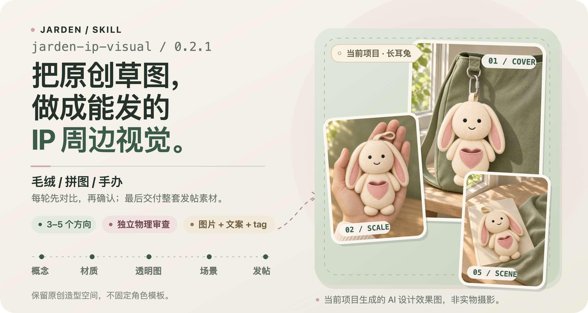

# jarden-ip-visual

<p align="center">
  
</p>

把原创 IP 的线框图、灵感图或平面 AI 图，逐步做成毛绒、手办、拼图等实体周边的商业视觉。每轮用 HTML 工作台看图、比较和确认：当前候选、上次交付、改动与保持项放在一起，最后交付可以直接发小红书的顺序图片、标题、正文与 tag。所有需要你确认、选择或反馈的事项都会同时在聊天正文说明；工作台只作查看和可选辅助提交，不要求你到页面里寻找反馈入口。

## 会得到什么

- 已知的品类、角色、用途和尺寸一起保存；只补当前缺项，继续会话时不重复问。用途可自由描述，尺寸可为数值、范围或可观察的定性目标，并区分本体与含配件口径。
- 四种笔记结构：同系列合集、IP 设计手稿、单个玩偶多维展示、多个玩偶多场景展示。
- 从概念、材质到透明资产、场景图的逐轮对比页；探索候选默认三方向，定向返修可一至两个；透明资产每角色一张，场景整组每图位一张。
- 当前轮、真实上次交付和比较基线分别展示；历史图片采用不可变快照，原图改动不会悄悄替换旧交付。
- 本机页面可辅助写回项目并读回回执；无服务时可保存草稿、复制指令和导出意向，但不会显示假成功，也不会把页面当作唯一反馈入口。
- 增加角度或修改指定图位时保留其他有效图片；恢复时核对生成回执，避免结果未决时重复调用。补图按钮先登记意向。
- 编号并统一为 3:4 的发布图片、可复制的文案与有序话题；九宫格正好九张，并另附预览。已审排版图可直接复用，只改正文不用重做图片。
- 默认干净无提示字的成图，AI 与未知规格说明留在文案和 HTML；只有你明确要求才加图字。
- 场景先检查镜头计划，再由独立 Agent 看真实图核对角色、设计尺度与视角；另一位隔离 Agent 检查支撑、连接件、人体接触和光影。实际发布集合还要检查完整覆盖和图序，未通过不交付定稿。

图片能力负责生成，本 Skill 负责需求确认、参考一致性、阶段确认、验收和最终整理。它不能保证每次一遍出图，用户可以补图或重做。

## 安装

本 Skill 位于公开仓库 [Jarden-Jin/jarden-skills](https://github.com/Jarden-Jin/jarden-skills) 的 `skills/jarden-ip-visual` 目录。版本只以 [SKILL.md](SKILL.md) 的 `metadata.version` 为准；源码版本与远端 Release 是否已发布需分别核对。

最方便的方式是告诉 Agent：

```text
请帮我安装这个 Skill：https://github.com/Jarden-Jin/jarden-skills/tree/main/skills/jarden-ip-visual
```

也可使用支持多 Skill 仓库的安装器：

```text
npx skills add Jarden-Jin/jarden-skills --skill jarden-ip-visual
```

手动安装时复制当前 jarden-ip-visual 目录到宿主支持的 skills 目录。npx 的 Node.js 依赖只属于可选安装方式。

## 开始使用

可以直接说：

```text
用 jarden-ip-visual 把这张原创草图做成毛绒挂件，要一套小红书素材。
```

也可以说「继续上次项目」「第二个方向再柔软一点」「把这组做成九宫格」。不需要背内部命令。

开始前提供一张或多张图，或清楚的文字想法。可以一次说「一只毛绒，本体 10–12 cm 不含挂扣，平时桌面摆放，也可拆下挂包，保留正面，再补背面」。Agent 保存这些约定，只补影响结果的缺项，不要求你填写镜头参数。尺寸是设计目标，画面里的手掌不能证明实物厘米数。

## 每轮怎样确认

Agent 会先保存真实图片与状态，再生成 HTML。分享本机服务链接前会做真实健康检查，只有确认可访问才展示；打开失败时保留静态页面和绝对路径，不会丢失图片。页面区分「已生成」「已请求打开」与「已核对显示」。

每轮待确认的问题、方向和修改选项会直接写在聊天正文，并附上已验证的页面入口。你在聊天里回复编号或明确要求即可，不需要先在页面点选；页面里的按钮只是可选辅助。

本机交互模式可选方向、逐张保留、写备注，再确认提交。只有项目核心写入成功且回执读回一致才显示「已采用」。重复点击不会重复推进；旧标签页、换图、缺图或必要审查未通过时会说明原因。

静态 HTML 可离线看图、保存草稿或导出意向，但不能直接写项目。页面会明确显示「尚未提交」；把意向交回对话后，Agent 再校验。如果你在页面里保存了草稿，可以回聊天说「继续」；直接在聊天里给编号、改法或选择同样有效，Agent 会按聊天原话登记，不会离线自动运行。

只想修改一张时，直接说图号和改法。工作台保留修改前后的可比版本及不变项；模糊反馈不会自动重做全部图片或更换角色。

恢复入口 `scripts/workbench.py` 会核对现有交付、选择回执和未决生成任务，可复用有效页面与本机服务。它不代你选图或自动生图；有真实提交回执就从下一步继续。侧背资料按实际镜头需求补齐，推断的隐藏面先确认；多视图仍是二维效果图。

## 配置与依赖

默认使用宿主原生/系统 `imagegen`，无需额外 Key。不可用时保留提示词、已有图片和待生成状态；不会因重试、路径或质量问题自动切换供应商、订阅转接或 API。只有你明确选择外部服务时才配置相应能力。

| 能力 | 依赖 |
| --- | --- |
| 需求、状态与 HTML | Python 3.10+，宿主可读取图片与写本地文件 |
| 本机交互工作台 | Python 标准库；仅监听 127.0.0.1，无额外 Web 框架 |
| 检查、去底、拼版、发布整理 | Pillow 和可用中文字体 |
| 真实生图 | 默认宿主原生/系统 imagegen；外部服务需明确选择 |
| G1 合同实际图验收 | 能独立看图的隔离 Agent；准备器仅接受合法非交错单帧 PNG，含所需参考图 |
| G2 物理验收 | Pillow 检查元数据；另一位不继承创作或 G1 对话的看图 Agent；没有时停止在待审 |
| 可选本机凭据输入页 | Node.js 22.18+、组件依赖及系统凭据服务 |

图片处理依赖可安装 `python3 -m pip install Pillow`；Windows 通常用 `py -3`。字体自动寻找系统中文字体，也可设置 JARDEN_IP_VISUAL_FONT。

明确选择第三方图片服务后，Agent 先检查已有配置与脱敏状态，再提供本机 Key 输入页。Key 留在系统凭据库，不要发在聊天里。普通接口设置单独存用户配置目录，支持 JARDEN_IP_VISUAL_HOME。

凭据组件首次安装依赖需在 scripts/credential-ui 目录运行 `npm ci --ignore-scripts`。详细步骤见 [图片后端](references/image-backends.md) 与 [组件说明](scripts/credential-ui/README.md)。

## 兼容范围

Python 脚本使用 pathlib 和跨平台接口；平台验证以对应的实际运行记录为准，不能从脚本或适配器存在推导已实测。Windows/Linux 的业务流程尚未实机验证。

凭据组件使用 macOS Keychain、Windows Credential Manager 或 Linux Secret Service。后两者有适配器，尚未在本 Skill 中实机验收；不可用时停止，不转为明文存储。

没有生图工具时可以保留提示词和带缺图标记的对比页，不能完成实际素材。没有 GUI 仍可生成 HTML，用户在自己的浏览器打开；离线时可整理已有图，不能调用云端生图。

独立创作、身份、整套图序和文案审查分别记录，不用某个总分豁免物理门槛；未评不等于通过。传播评审检查封面识别、图间信息增量、场景代入和 tag 相关性，不保证实际流量或销量。

G1 检查实际图是否符合身份、尺度和镜头约定，G2 检查可见物理；两者分开送审，只接受适用的 pass，不确定仍待处理。候选仅验本批不代表可发布，最终验完整集合。未改图片可按当前合同和摘要复用审查，整套排列变化仍须重验。程序不能证明审查者实际独立或完成了看图，也不把效果图当成实测、仿真或工程证明。宿主负责让两类审查者与上下文分开。详见 [产品与镜头接口](references/product-and-shots.md) 和 [物理审查](references/physics-review.md)。

## 数据与功能边界

项目记录、原图副本、生成图片和 HTML 默认留在用户选的本地目录。调用图片能力时，提示词和指定的参考图会发到该能力背后的服务；具体接收方与费用以用户选择的服务为准。

API Key 保存在当前用户的系统凭据库，运行时只注入可信业务程序；不自动同步。这减少凭据进入聊天的机会，不是对同用户任意代码执行的强隔离。

只制作设计与发布素材，不做 3D 建模、工程打样文件、商品上架、自动发布、版权确权或商业效果保证。普通单图、单纯抠图和非 IP 文案交给对应工具。

保留原创空间：四类结构规定每张图的作用，不固定角色造型或配色。未经提供的价格、尺寸与发售时间不会写成事实。AI 说明保留在文案、HTML及发布页声明，不默认印在图里；打包器不能自动识别并擦除原图已有文字。

## 测试与排查

在本目录运行：

```text
python3 -m unittest discover -s tests -v
```

发行构建相关测试需要源码仓库的 `tools/build_release.py`，独立安装缺少所需源码时会跳过；完整回归在源码仓库运行。生成 ledger 另有仓库根 `tests/` 用例，工作台也在本 Skill 的 tests 中检查；这些临时项目和模拟协议不代表真实看图、线上生图或 Release 链路已验证。原生系统凭据测试需显式开启，不将默认跳过算作通过。

凭据组件的检查在它自己的目录运行 `npm run check`、`npm run build`、`npm test`；原生假凭据验证用 `npm run test:native`，会清理随机测试项。

失败后保留项目，告诉 Agent 继续同一个目录。原生生图超时或结果丢失时先核对 ledger、工具回执和现有文件；requesting/unknown 不能直接重发，找回真实输出后继续登记。已完成字节继续复用，明确重做另记新的生成意图。

透明背景问题可运行 check_images.py --alpha；发布整理先用 package_post.py --dry-run 查看缺项。图片比例、标题和话题采用保守交付预算，发布前以当前账号发布页的校验为准。

## 更新与旧项目

开始或恢复先查本地状态与未完成事务；普通创作的联网版本检查放在首图交付后，或你明确维护时，可关闭或离线使用。检查失败不阻断创作；工作台的维护区只显示缓存，检查和查看计划按钮生成回对话发送的请求，不会自行安装。

告诉 Agent「检查 jarden-ip-visual 更新」只检查固定仓库的发行，不改安装。明确要求升级某个版本后，Agent 先展示版本、来源、文件改动、备份与恢复计划，再执行已授权更新。本地修改、源码 checkout、共享符号链接或正在运行的业务不会被盲目覆盖。

更新只处理 Skill 代码，不读取图片 Key，也不会扫描或迁移所有项目。旧项目可只读查看；继续写入前单独预览 schema 迁移，并保留原文件、未知字段、图片、选择和审查。代码回滚不回滚项目，旧代码不能盲写新 schema。

当前项目代码读 schema 1/2/3、只写 3。`0.2.1` 旧更新器不接受 schema 3 发行声明：必须先显式 `plan --version 0.2.2`，安装并核验桥接版成功后，再用新版入口 `plan --version 0.3.0`。这些是升级目标示例，需先确认对应公开 Release 及资产已存在；检查到最高版本不会自动完成桥接。

更新入口是 `scripts/check_update.py`，迁移入口是 `scripts/migrate_project.py`；命令、来源、外部备份和失败恢复见 [更新说明](references/updates.md) 与 [项目状态](references/project-state.md)。

需要查具体命令时，另见 [HTML 与 workbench](references/html-delivery.md)。产品约定、镜头增量、G1/G2 和 prepared 实际图复用的接口集中在上述参考文档，README 只保留使用入口。

## 源码与许可证

源码维护在公开仓库 [Jarden-Jin/jarden-skills](https://github.com/Jarden-Jin/jarden-skills)，当前未附带开源许可证；公开可读不等于已授予开源许可。远端发布、平台实机和第三方线上接口验证须有各自记录，不以本文的命令示例或测试用例替代。
